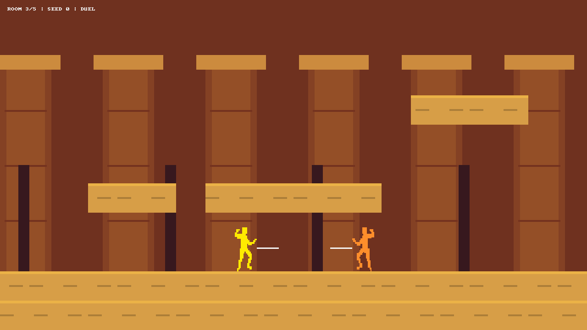
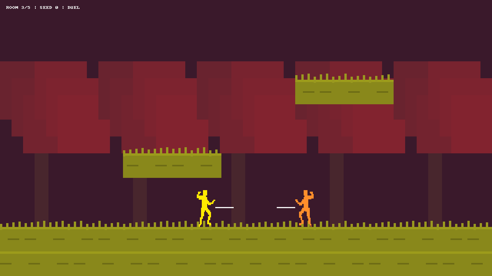
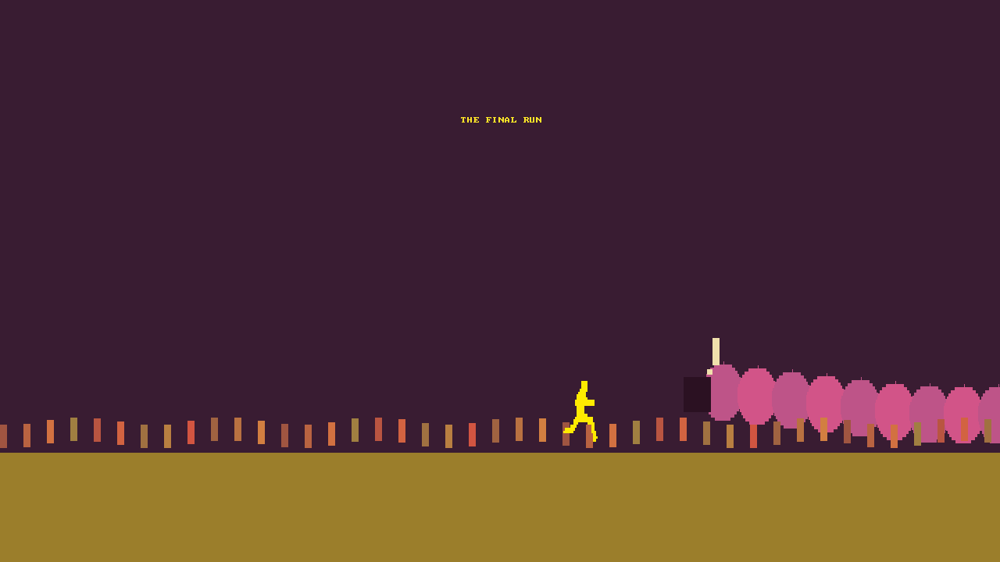

# Comparaison avec Nidhogg (premier jeu, 2014)

## Référence examinée

Comparaison du dépôt au commit `8f35f27`, puis modifications décrites ci-dessous.
Sources consultées :

- [Messhof : présentation officielle et trois clips animés](https://messhof.com/nidhogg).
- [Steam : fiche officielle de Nidhogg et captures](https://store.steampowered.com/app/94400/Nidhogg/).
- [Guide communautaire « Nidhogg Technique »](https://steamcommunity.com/sharedfiles/filedetails/?id=216329928).
- [Guide communautaire « How to Play Nidhogg »](https://steamcommunity.com/sharedfiles/filedetails/?id=216758699).

J'ai extrait et inspecté plusieurs images de chacun des trois GIF de gameplay
publiés par Messhof, ainsi qu'une capture officielle Steam complète. La bande-annonce
YouTube liée par Messhof n'a pas pu être récupérée ; je ne prétends pas l'avoir regardée.
Le jeu commercial n'a pas été exécuté dans cette session. Les guides de joueurs
complètent les sources officielles ; ce ne sont pas des spécifications du moteur.
Aucun exécutable ni nouvel asset commercial n'a été ajouté au dépôt.

## Comparaison et corrections

Les règles synthétisées dans les huit premières lignes reposent sur les deux guides
ci-dessus, recoupés avec les actions mentionnées dans la fiche officielle.

| Élément | Référence | Avant cette comparaison | Maintenant |
| --- | --- | --- | --- |
| Défense | Blocage à garde égale | Désarmement automatique | Blocage et recul ; épée conservée |
| Désarmement | Changement de hauteur au croisement | Assimilé au blocage | Garde fraîche et chevauchement requis |
| Mobilité basse | Accroupissement, roulade, passage sous les lames | Roulade invulnérable | Corps abaissé ; garde basse létale |
| Air | Coup de pied plongeant | Estoc aérien | Coup plongeant qui désarme et met au sol |
| Corps à corps | Poings, balayage, mise au sol, exécution | Deux frappes tuaient | Deux poings mettent au sol ; exécution séparée |
| Lancer | Déplacement rectiligne, commande contextuelle | Arc gravitationnel et expiration | Trajectoire horizontale jusqu'au contact ; haut + attaque |
| Murs | Déplacements et sauts muraux | Blocage simple | Glissade, montée et saut mural |
| Commandes | Bas pendant le déplacement ; attaque contextuelle | Bas + saut pour rouler | Bas + direction ; bas + attaque pour balayer |
| Progression | Droit de passage conservé après un kill, défenseur devant | Déjà présent | Signal GO plus lisible, cadrage rapproché et salles fixes |
| Présentation | Silhouettes jaune/orange, pixel art, lieux contrastés | Personnages petits, décor gris | Échelle visuelle doublée, couleurs et décors thématiques |
| Terrains | Château, végétation, mines, nuages | Un décor générique | Quatre thèmes sélectionnables ; nuages qui cèdent |
| Conclusion | Arrivée victorieuse et créature géante | Tableau de statistiques seul | Course finale, foule et serpent cornu animé, puis statistiques |

Les deux dernières lignes s'appuient sur les présentations et images officielles,
ainsi que la description de l'objectif du guide How to Play. Les décors et la créature
ajoutés sont des dessins procéduraux originaux, pas des copies des images consultées.

## Décisions et différences qui restent

Le résultat est une version plus proche du duel de Nidhogg, pas un portage de son moteur.
Les timings ne sont pas mesurés image par image. Le délai de réapparition est fixé à
5 secondes comme point de départ issu du guide Technique, qui l'indique approximativement.
Les valeurs de portée, vitesse et fenêtres de contact sont des réglages du projet.

- Les quatre thèmes évoquent les environnements du premier jeu, mais leurs agencements
  ne reproduisent pas exactement les niveaux commerciaux. Les cinq salles de la partie
  sont conservées ; le nombre de salles n'est pas présenté comme une mesure universelle
  de toutes les versions du jeu original.
- Cartwheel, en-garde avancée et accroche de rebord n'ont pas chacun une machine d'animation
  dédiée. La roulade courte conserve la garde, le maintien prolonge le mouvement, et les
  sauts muraux permettent déjà une partie de cette mobilité.
- Le son synthétisé reste une création du projet. Il ne reproduit pas la musique dynamique
  de Daedelus, citée par Messhof et Steam. Les effets de mort restent simplifiés.
- Les modes tournoi et jeu en ligne/rollback de la fiche Steam ne sont pas implémentés.
  Le périmètre travaillé ici est le duel local ou contre l'IA du dépôt existant.
- Aucun pourcentage de fidélité n'est avancé. Une comparaison humaine des sensations
  nécessite les deux jeux exécutés côte à côte, avec les mêmes commandes et cadence.

## Vérification

Une sixième cible CTest, `nidhogg_tests`, vérifie les règles ci-dessus : blocage sans perte
d'arme, changement de garde qui désarme, roulade transpercée en bas mais passant sous une
garde haute, saut sur une lame, coup plongeant, balayage, absence d'invincibilité de roulade,
saut mural, lancer horizontal et commandes contextuelles. Elle vérifie les quatre thèmes,
les deux projectiles simultanés, la disparition d'un nuage et génère leurs captures ainsi que celle de la conclusion.
Les anciennes assertions incompatibles avec la référence ont été remplacées par ces règles,
sans neutraliser les contrôles de collision, statistiques et architecture.

Captures produites par notre renderer :

